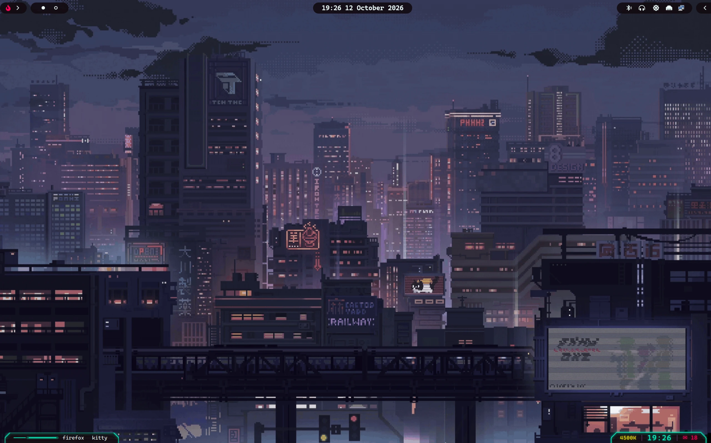
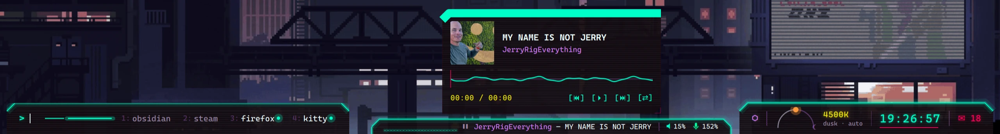

# dots

A cyberpunk-neon rice for [niri](https://github.com/YaLTeR/niri) on NixOS,
managed with [home-manager](https://github.com/nix-community/home-manager).
Only the hand-made parts are here: the compositor config, the bar, the
terminal, the prompt, the editor theme and the Spotify popup. Package lists
and generic desktop plumbing are left out.



The bottom rail unfolded: launcher with pinned apps, media card with cava
visualiser, system island with night-light, clock and notifications. In the
middle is `spotify-mini`, spotify-player inside a `kitten panel` overlay
(Mod+M toggles it; `modules/terminal/spotify-player.nix`).



| Piece          | What                                                                 |
| -------------- | -------------------------------------------------------------------- |
| Compositor     | niri (`config/niri/config.kdl`, `modules/wm/niri.nix`)               |
| Bar            | [quickshell](https://quickshell.org) bottom rail with app / media / system islands, launcher, notification daemon (`config/quickshell/bottom`, `modules/bar/quickshell-bottom.nix`) |
| Bar (fallback) | waybar, adapted from [cebem1nt/dotfiles](https://github.com/cebem1nt/dotfiles) (`config/waybar`, `modules/bar/waybar.nix`, `scripts/waybar`) |
| Terminal       | kitty with the built-in `cyberpunk` theme (`modules/terminal/kitty.nix`) |
| Prompt         | starship, colours from kitty's cyberpunk mapped onto the [SilkCircuit](https://github.com/hyperb1iss/silkcircuit) layout with [tr3ss](https://github.com/tr3ss/starship-themes) ice separators (`modules/shell/zsh.nix`) |
| Editor         | helix + nixd (`modules/editors/helix.nix`, `themes/helix/cyberpunk.toml`) |
| Spotify        | spotify-player as a kitten-panel popup and as a floating visualiser window (`modules/terminal/spotify-player.nix`, `themes/spotify-player/cyberpunk.toml`) |

## Palette

Every piece is tuned to kitty's built-in **cyberpunk** theme:

| role       | hex       |
| ---------- | --------- |
| background | `#120B10` |
| text       | `#EEFFFF` |
| cyan       | `#00FFC8` |
| pink       | `#FF0055` |
| purple     | `#D57BFF` |
| yellow     | `#F4EF00` |
| green      | `#00FF9C` |
| selection  | `#563466` |
| dim        | `#6d5a78` |

## Layout

```
home.nix            # entry point — imports ./modules
modules/
  default.nix       # imports every module below
  identity.nix      # CHANGE ME: username / home dir / stateVersion
  shell/zsh.nix     # zsh + starship prompt + zoxide
  editors/helix.nix
  terminal/         # kitty.nix, spotify-player.nix
  bar/              # quickshell-bottom.nix, waybar.nix
  wm/niri.nix       # sources config/niri/config.kdl
config/
  niri/config.kdl
  quickshell/bottom/   # the bar: QML + services
  waybar/              # config.jsonc, modules.jsonc, style.css, colors/, context/
scripts/waybar/        # helper scripts deployed to ~/.local/bin
themes/                # helix and spotify-player colour files
```

Standalone files (QML, KDL, CSS, TOML) are referenced from the modules with
`.source = ./path` rather than inlined as Nix strings, so they keep their
syntax highlighting and can be test-run without a rebuild. The niri config
has one `@POLKIT_GNOME@` placeholder that `modules/wm/niri.nix` substitutes at
build time.

## Using it

1. Edit `modules/identity.nix`.
2. Point home-manager at `home.nix`, for example from a NixOS flake:

   ```nix
   home-manager.users.<you> = import ./dots/home.nix;
   ```

3. The system side needs, at minimum:

   ```nix
   programs.niri.enable = true;
   programs.xwayland.enable = true;
   xdg.portal = {
     enable = true;
     extraPortals = [ pkgs.xdg-desktop-portal-gnome pkgs.xdg-desktop-portal-gtk ];
     config.common.default = "*";
   };
   services.pipewire = { enable = true; pulse.enable = true; };
   security.polkit.enable = true;
   programs.dconf.enable = true;
   fonts.packages = with pkgs; [ nerd-fonts.caskaydia-cove nerd-fonts.profont ];
   ```

   The bar uses *CaskaydiaCove Nerd Font Propo*, kitty *ProFont IIx Nerd Font
   Mono*.

4. The niri config and the waybar modules spawn a few tools that are not part
   of this tree: `awww` (wallpaper), `swaylock`, `swayosd-client`, `wlogout`,
   `nm-applet`, `playerctl`, `nemo`, and waybar's power module calls
   a `power-cycle` script from the private config. Add them to your packages
   or trim the binds.

5. Drop a wallpaper at `~/Pictures/Wallpapers/` (the bar's wallpaper strip
   reads that folder, `awww` paints it).

Pick modules à la carte if you don't want the whole thing: each file under
`modules/` is self-contained apart from the `config/` and `themes/` files it
sources.

## Credits

- waybar config: [cebem1nt/dotfiles](https://github.com/cebem1nt/dotfiles)
- starship layout: [SilkCircuit](https://github.com/hyperb1iss/silkcircuit) (MIT)
- starship separators: [tr3ss/starship-themes](https://github.com/tr3ss/starship-themes) (MIT)
- kitty `cyberpunk` theme: shipped with kitty-themes

This tree is generated from a private config by a scrub script, so paths and
names are placeholders where they used to be personal.

## License

MIT, see [LICENSE](LICENSE).
